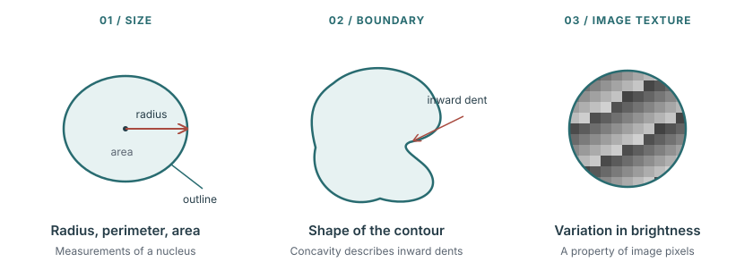
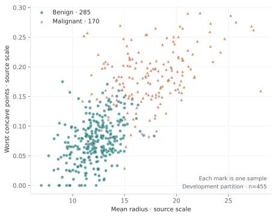
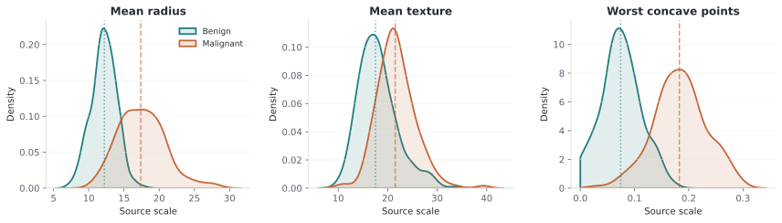
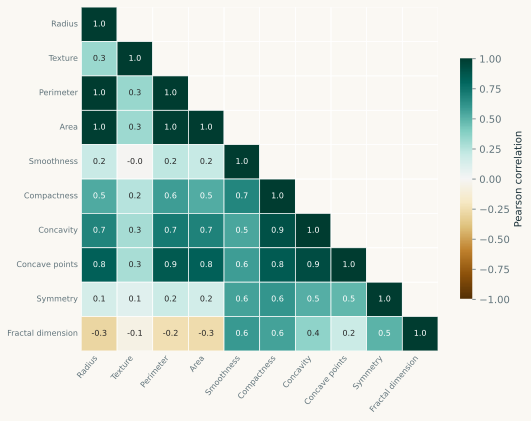
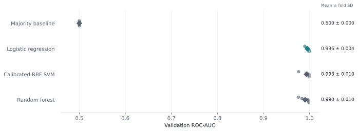
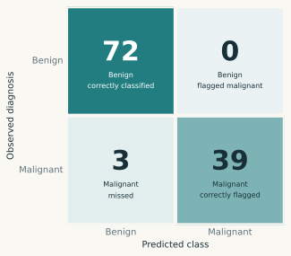
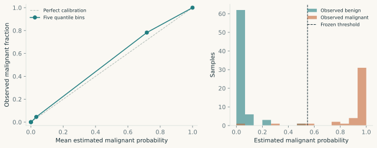

```{=html}
<div class="study">
  <section class="hero" aria-labelledby="study-title">
    <div class="hero-opening">
      <p class="eyebrow">From sample to signal <span>A study by Rob Calimente</span></p>
      <p class="subject-line">Breast cancer classification / Python + SQL</p>
      <h1 id="study-title">What does<br>a model <em>miss?</em></h1>
      <p class="hero-deck">Thirty cell measurements can carry a strong signal about a breast mass. This study follows that signal from source data to a model’s decisions.</p>
    </div>
    <figure class="outcome-map">
      <picture><source media="(max-width: 600px)" srcset="site/assets/holdout-outcomes-mobile.svg"></picture>
      <figcaption><span class="outcome-key"><i class="correct-key" aria-hidden="true"></i><strong>111</strong> correctly classified</span><span class="outcome-key"><i class="missed-key" aria-hidden="true"></i><strong>3</strong> malignant samples missed</span><span class="outcome-map-note">Retrospective model evaluation · One mark per holdout sample · Source row order</span></figcaption>
    </figure>
    <div class="hero-invitation"><p>The model got 111 of 114 reserved samples right. The 3 it missed deserve a closer look. To understand those decisions, start with the data.</p><a class="begin-link" href="#source">Follow the evidence <span aria-hidden="true">↓</span></a></div>
  </section>

  <nav class="study-index" aria-label="Study chapters">
    <details><summary>Six chapters, from sample to conclusion</summary>
      <ol>
        <li><a href="#source">Understand the sample</a></li>
        <li><a href="#pipeline">Establish trust in the data</a></li>
        <li><a href="#exploration">Investigate the signal</a></li>
        <li><a href="#models">Choose a model</a></li>
        <li><a href="#decisions">Explore the decision threshold</a></li>
        <li><a href="#evaluation">Evaluate the result and its limits</a></li>
      </ol>
    </details>
  </nav>

  <section class="chapter" id="source" aria-labelledby="source-title">
    <div class="chapter-label"><span class="chapter-number">01</span><span class="chapter-name">The sample</span></div>
    <div class="chapter-intro">
      <h2 id="source-title">What are we actually measuring?</h2>
      <p>A breast mass is a lump or abnormal area in the breast. Its diagnosis may be <strong>benign</strong> (non-cancerous) or <strong>malignant</strong> (cancerous). Cancer involves cells growing out of normal control. Malignant tumors can invade nearby tissue and spread elsewhere in the body; benign tumors do not invade or spread in that way. <a class="citation" href="https://www.cancer.gov/about-cancer/understanding/what-is-cancer">NCI: What is cancer?</a></p>
      <p>Here, the measurements describe <strong>cell nuclei</strong>: the DNA-containing structures inside cells. Radius and area refer to nuclei in an image, not the dimensions of the breast lump. <a class="citation" href="https://www.cancer.gov/publications/dictionaries/cancer-terms/def/nucleus">NCI: Nucleus</a> · <a class="citation" href="https://archive.ics.uci.edu/dataset/17/breast+cancer+wisconsin+diagnostic">Dataset source</a></p>
    </div>

    <div class="domain-prose">
      <h3>From the sample to the spreadsheet.</h3>
      <p>A <strong>fine-needle aspiration (FNA)</strong> uses a thin needle to collect cells or fluid. In the original research, sample preparations were digitized, and an operator and software identified nuclear outlines. The computer then measured their appearance. <a class="citation" href="https://www.cancer.gov/types/breast/diagnosis">NCI: Breast biopsy</a> · <a class="citation" href="https://pubmed.ncbi.nlm.nih.gov/7628853/">Original study</a></p>
    </div>
    <div class="sample-chain" role="img" aria-label="Breast mass, then fine-needle aspiration sample, then digitized cell nuclei, then thirty numeric features per sample.">
      <span>Breast mass</span><i aria-hidden="true">→</i><span>FNA sample</span><i aria-hidden="true">→</i><span>Digitized nuclei</span><i aria-hidden="true">→</i><span>30 features</span>
    </div>
    <p class="small">This project begins with the resulting numeric table. Each row summarizes one sampled breast mass; it is not one individual cell.</p>
    <p class="dataset-summary"><strong>569 samples</strong> · <strong>30 measurements</strong> · <strong>2 diagnosis classes</strong></p>

    <div class="domain-prose">
      <h3>Read the measurements before the chart.</h3>
      <p>The descriptors capture three broad ideas: <strong>size</strong>, <strong>boundary shape</strong>, and <strong>image texture</strong>. Texture means variation in grayscale brightness, not how a lump feels. <a class="citation" href="https://scikit-learn.org/stable/datasets/toy_dataset.html#breast-cancer-wisconsin-diagnostic-dataset">Feature definitions</a></p>
    </div>
    <figure class="figure-wide biology-figure">
      <picture><source media="(max-width: 600px)" srcset="site/assets/nuclear-measurements-mobile.svg"></picture>
      <figcaption>Conceptual drawings, not specimen images or to scale. The drawings have no diagnosis. Their purpose is to make the feature names readable.</figcaption>
    </figure>
    <details class="domain-details"><summary>Explore all ten nuclear measurements</summary>
      <dl class="feature-glossary">
        <div><dt>Radius</dt><dd>Average center-to-boundary distance.</dd></div>
        <div><dt>Perimeter</dt><dd>Boundary length.</dd></div>
        <div><dt>Area</dt><dd>Region enclosed by the boundary.</dd></div>
        <div><dt>Smoothness</dt><dd>Small-scale variation in radius.</dd></div>
        <div><dt>Compactness</dt><dd>A descriptor relating perimeter and area.</dd></div>
        <div><dt>Concavity</dt><dd>Severity of inward dents.</dd></div>
        <div><dt>Concave points</dt><dd>Number of concave contour portions.</dd></div>
        <div><dt>Symmetry</dt><dd>How balanced the shape is.</dd></div>
        <div><dt>Fractal dimension</dt><dd>A descriptor of contour complexity.</dd></div>
        <div><dt>Texture</dt><dd>Standard deviation of grayscale values.</dd></div>
      </dl>
      <p class="small">Plain-language descriptions of the documented features. See the <a href="https://scikit-learn.org/stable/datasets/toy_dataset.html#breast-cancer-wisconsin-diagnostic-dataset">dataset feature definitions</a> and <a href="data/README.md">local dictionary</a> for the stored names.</p>
    </details>
    <div class="source-definition">
      <h3>Ten properties become thirty features.</h3>
      <p>Each property has three summaries across the measured nuclei. <a class="citation" href="https://scikit-learn.org/stable/datasets/toy_dataset.html#breast-cancer-wisconsin-diagnostic-dataset">Dataset documentation</a></p>
      <dl class="measurement-groups">
        <div><dt>Mean</dt><dd>The average.</dd></div>
        <div><dt>Standard error</dt><dd>An estimate of uncertainty in the mean.</dd></div>
        <div><dt>Worst</dt><dd>The mean of the three largest values.</dd></div>
      </dl>
      <p class="small">“Worst” is just a feature-summary name. It does not rate how advanced a cancer is. A column such as <code>radius_worst</code> cannot tell us the clinical size of the lump or whether cancer has spread.</p>
    </div>
    <figure class="figure-wide source-figure">
      
      <figcaption>Two nuclear descriptors, each summarized per sample. Position shows the measurements; color and shape identify the recorded diagnosis. Neither axis is a clinical tumor-size or cancer-stage measure.</figcaption>
    </figure>
    <details class="domain-details"><summary>Who was included in the original research?</summary>
      <p>The original publication describes 212 patients with cancer and 357 with fibrocystic breast masses, a benign diagnostic group. This was a particular comparison cohort, not a survey of every benign breast condition. Its composition matters when considering where a model might generalize. <a class="citation" href="https://pubmed.ncbi.nlm.nih.gov/7628853/">Wolberg and colleagues, 1995</a></p>
    </details>
    <p class="small">Source: <a href="https://archive.ics.uci.edu/dataset/17/breast+cancer+wisconsin+diagnostic">UCI Wisconsin Diagnostic Breast Cancer</a> · 357 benign / 212 malignant · CC BY 4.0. The identifier is retained for tracing samples and excluded from predictors.</p>
  </section>

  <section class="chapter" id="pipeline" aria-labelledby="pipeline-title">
    <div class="chapter-label"><span class="chapter-number">02</span><span class="chapter-name">The pipeline</span></div>
    <div class="chapter-intro">
      <h2 id="pipeline-title">Establish trust before finding patterns.</h2>
      <p>A small dataset still needs a reliable path from source to analysis. Source bytes are preserved, checked against a recorded SHA-256 hash, validated against an explicit schema, and transformed into Parquet tables.</p>
    </div>
    <ol class="pipeline-route" aria-label="Data preparation and evaluation split">
      <li><span class="route-number" aria-hidden="true">1</span><div><h3>Preserve the source.</h3><p><strong>569 rows</strong>, retained as the original UCI snapshot. A recorded checksum identifies the accepted bytes.</p></div></li>
      <li><span class="route-number" aria-hidden="true">2</span><div><h3>Validate the observations.</h3><p><strong>9 checks passed.</strong> The contract covers schema, labels, missing values, duplicates, and measurement validity.</p></div></li>
      <li><span class="route-number" aria-hidden="true">3</span><div><h3>Reserve the final evidence.</h3><p><strong>455 development samples</strong> support exploration and model choices. Another <strong>114 samples</strong> are held back until the model and threshold are frozen.</p></div></li>
    </ol>
    <div class="engineering-notes">
      <div><h3>Clean data is a finding.</h3><p>The source passed the checks. There were no missing values to impute or duplicate rows to remove. Invalid labels, schema changes, and non-finite measurements are rejected; labeled test fixtures verify that behavior.</p></div>
      <div><h3>Every result has a route back.</h3><p>The pipeline saves source and artifact hashes, split assignments, SQL summaries, a model freeze, and an evaluation record. Reruns verify the frozen study and reuse its final results.</p></div>
    </div>
    <details><summary>Inspect a development-only SQL summary</summary><pre class="inline-code">SELECT diagnosis, count(*) AS samples,
       median(radius_mean) AS median_radius
FROM samples
WHERE partition = 'development'
GROUP BY diagnosis;</pre><p class="small">DuckDB queries the validated table directly. <a href="notebooks/01_data_audit.html">Open the data audit →</a></p></details>
  </section>

  <section class="chapter" id="exploration" aria-labelledby="exploration-title">
    <div class="chapter-label"><span class="chapter-number">03</span><span class="chapter-name">The signal</span></div>
    <div class="chapter-intro"><h2 id="exploration-title">Separation is useful. Overlap matters too.</h2><p>Class distributions differ, but a single measurement does not settle every case. These figures use only the 455 development samples; the holdout does not guide exploratory choices.</p></div>
    <div class="domain-prose">
      <h3>Why appearance is worth investigating.</h3>
      <p>A pathologist is a doctor who examines cells and tissue to help diagnose disease. Nuclear size and shape also contribute to breast-cancer grading, an assessment of microscopic abnormality. That gives morphology, the study of form, a biological reason to be investigated. This dataset's binary diagnosis is a different target from grade. <a class="citation" href="https://www.cancer.gov/types/breast/stages">NCI: Grading and staging</a></p>
      <p>The original researchers tested whether measured nuclear appearance could distinguish their benign and malignant groups. <a class="citation" href="https://pubmed.ncbi.nlm.nih.gov/7628853/">Original research</a> In our development partition, the median mean-radius value is <strong>17.4 for malignant samples</strong> and <strong>12.2 for benign samples</strong>, on the source scale.</p>
      <p>The typical values differ, but the distributions overlap. A larger value is an association in this cohort, not a stand-alone diagnosis. The charts below show both the separation and the exceptions.</p>
    </div>
    <figure class="figure-wide"><picture><source media="(max-width: 600px)" srcset="site/assets/distributions-mobile.svg"></picture><figcaption>Class distributions on the development partition. Vertical lines mark medians; density curves are descriptive smoothing. Measurements stay on the source scale because physical units are not established in the data dictionary.</figcaption></figure>
    <div class="eda-detail">
      <h3>Thirty columns do not mean thirty independent signals.</h3>
      <p>Mean radius and mean perimeter have a Pearson correlation of 0.998 in the development data. Several size-related measurements move together. Geometrically, radius, perimeter, and area describe related aspects of size; they are not three independent confirmations of cancer.</p>
      <figure class="figure-wide"><figcaption>Ten mean measurements · Development data only. <a href="site/assets/correlations.svg" target="_blank" rel="noopener">View full-size chart</a>.</figcaption></figure>
      <p>That supports comparing a regularized linear model with nonlinear alternatives. All thirty measurements remain in the models; no feature ranking is fitted on the full dataset.</p>
      <p class="small">Association does not establish causation, and correlated predictors can make individual feature-importance rankings unstable.</p>
      <a class="text-link" href="notebooks/02_exploration.html">Read the exploration →</a>
    </div>
  </section>

  <section class="chapter model-section" id="models" aria-labelledby="model-title">
    <div class="chapter-label"><span class="chapter-number">04</span><span class="chapter-name">The model</span></div>
    <div class="chapter-intro"><h2 id="model-title">The choice: logistic regression.</h2><p><strong>It was the simplest candidate and had the highest average validation score.</strong> The more complex alternatives did not improve that score, so I kept the simpler model.</p></div>
    <div class="model-results">
      <table class="model-choice-table">
        <caption>Average ROC-AUC across the five development folds · Higher is better</caption>
        <thead><tr><th scope="col">Candidate</th><th scope="col">Mean ROC-AUC</th></tr></thead>
        <tbody>
          <tr class="chosen-model"><th scope="row">Logistic regression <span class="chosen-label">Selected</span></th><td><strong>0.9956</strong></td></tr>
          <tr><th scope="row">Calibrated RBF SVM</th><td>0.9935</td></tr>
          <tr><th scope="row">Random forest</th><td>0.9904</td></tr>
          <tr><th scope="row">Majority-class baseline</th><td>0.5000</td></tr>
        </tbody>
      </table>
      <h3>Why choose it over the other models?</h3>
      <p>I compared all four candidates on the same five splits of the 455 development samples. Each round trained on four parts and scored the remaining part. Every development sample was therefore scored by a model that had not trained on it.</p>
      <p>The comparison uses <strong>ROC-AUC</strong>: how well a model ranks malignant samples above benign ones across possible cutoffs. A score of 0.5 is chance-level ranking; 1.0 is perfect ranking. Accuracy and missed samples are assessed separately, after choosing a cutoff. <a class="citation" href="https://scikit-learn.org/1.7/modules/model_evaluation.html#roc-metrics">About ROC-AUC</a></p>
      <p>The SVM can learn a curved boundary between groups; the forest combines many decision trees. Those were useful alternatives to test, but neither earned a higher mean validation score here.</p>
      <p><strong>The selection rule was set before training:</strong> choose the simplest candidate within 0.005 of the best mean ROC-AUC. The declared order was logistic regression, calibrated RBF SVM, then random forest. Logistic regression satisfied that rule and also ranked first on the mean score. The 0.005 allowance was a study design choice, not a statistical test of equivalence.</p>
      <p>Keeping one scaler and one weighted model makes the pipeline easier to inspect and reproduce. These small score differences do not establish that logistic regression is best for every dataset or that it is ready for clinical use.</p>
      <figure class="figure-wide"><figcaption>Dots: individual folds. Diamonds: means. Logistic regression's fold standard deviation was 0.004. This describes variation across splits; it is not a confidence interval.</figcaption></figure>
      <h3>What does logistic regression actually do?</h3>
      <p>It learns a weighted combination of the thirty nuclear measurements to estimate whether a sample belongs to the malignant group. The weights are learned from samples with known diagnoses. Despite the word “regression,” this is a classification model: its output helps distinguish two groups.</p>
      <ol class="model-steps" aria-label="How the selected model makes a prediction">
        <li><strong>Put measurements on a common scale.</strong><span>Area and texture have very different numerical ranges. A scaler centers each measurement and adjusts its spread using only the training samples.</span></li>
        <li><strong>Combine the evidence.</strong><span>The model multiplies each scaled measurement by a learned weight, then adds the contributions and an intercept. L2 regularization, a penalty on large weights, discourages an overly extreme fit.</span></li>
        <li><strong>Turn the score into a probability.</strong><span>A smooth S-shaped function maps the combined score to a value between 0 and 1. Higher values mean the model assigns a greater probability to the malignant label. A separate cutoff turns that estimate into a class prediction.</span></li>
      </ol>
      <p class="small">The weights describe the fitted model's associations. Correlated measurements make them unsuitable as isolated explanations of what causes cancer. <a class="citation" href="https://scikit-learn.org/1.7/modules/linear_model.html#logistic-regression">How logistic regression works</a></p>
      <p><strong>The model choice and the decision cutoff are separate choices.</strong> First I selected this pipeline using development data. Next I chose its cutoff, also using development data. Both were frozen before evaluating the 114 reserved samples. The next chapter shows why the cutoff changes which mistakes the model makes.</p>
      <p class="small">Scaling is fitted inside training folds. SVM calibration wraps the entire scaler-model pipeline inside its own training folds. No oversampling is used.</p>
      <a class="text-link" href="notebooks/03_model_selection.html">Inspect model development →</a>
    </div>
  </section>

  <section class="chapter" id="decisions" aria-labelledby="decision-title">
    <div class="chapter-label"><span class="chapter-number">05</span><span class="chapter-name">The tradeoff</span></div>
    <div class="chapter-intro"><h2 id="decision-title">A probability still needs a decision.</h2><p>Lowering the threshold flags more samples as malignant. That can catch more malignant samples while also flagging more benign ones. Move the threshold to see both sides of the tradeoff.</p></div>
    <div class="explorer" id="threshold-explorer">
      <div class="explorer-top"><div class="chart-label">Development predictions · 455 samples</div><button id="reset-threshold" type="button" disabled>Use development choice ↺</button></div>
      <div class="threshold-control"><div><label for="threshold">Classify as malignant at or above this probability</label><input type="range" id="threshold" min="0" max="1000" step="1" disabled aria-describedby="explorer-caption"><div class="range-endpoints"><span>0.00 · flag every sample</span><span>1.00 · flag only probabilities of 1</span></div></div><output id="threshold-value" for="threshold">0.5478</output></div>
      <div class="outcome-row"><div class="outcome-label">Observed malignant<small>Correctly flagged</small></div><div class="outcome-track" aria-hidden="true"><div id="malignant-good" class="outcome-good"></div><div id="malignant-error" class="outcome-error"></div></div><div class="outcome-readout" id="malignant-detected">—</div></div>
      <div class="outcome-row"><div class="outcome-label">Observed benign<small>Correctly cleared</small></div><div class="outcome-track" aria-hidden="true"><div id="benign-good" class="outcome-good"></div><div id="benign-error" class="outcome-error"></div></div><div class="outcome-readout" id="benign-cleared">—</div></div>
      <div class="outcome-legend"><span>Correctly classified</span><span>Misclassified</span></div>
      <div class="explorer-numbers"><div><strong id="fn-count">—</strong><span>Malignant samples missed</span></div><div><strong id="fp-count">—</strong><span>Benign samples flagged</span></div><div><strong id="sensitivity">—</strong><span>Sensitivity · malignant detected</span></div><div><strong id="specificity">—</strong><span>Specificity · benign cleared</span></div></div>
      <span id="tp-count" class="visually-hidden"></span><span id="tn-count" class="visually-hidden"></span>
      <p id="explorer-caption" class="explorer-caption">These are out-of-fold development predictions from the selected candidate. They support exploration and threshold selection, and are optimistic after model selection. The illustrative rule maximizes specificity while reaching at least 95% development sensitivity. It is not a clinical standard.</p>
      <p id="explorer-status" class="visually-hidden" role="status" aria-live="polite">Loading development predictions.</p>
      <noscript><p class="small">Enable JavaScript to explore thresholds. The chosen threshold is 0.547828; the development results are also available in the methods page.</p></noscript>
    </div>
    <p class="small">The chosen threshold, 0.547828, was frozen before final evaluation. Moving this control does not change the final results below.</p>
  </section>

  <section class="chapter" id="evaluation" aria-labelledby="evaluation-title">
    <div class="chapter-label"><span class="chapter-number">06</span><span class="chapter-name">The evidence</span></div>
    <div class="chapter-intro"><h2 id="evaluation-title">The three samples it missed.</h2><p>The selected pipeline was fitted on development data and evaluated on 114 reserved samples at the frozen threshold. The result: 111 correct classifications, 3 missed malignant samples, and 0 benign samples flagged.</p></div>
    <p>A <strong>false negative</strong> is a malignant-labeled sample classified as benign. A <strong>false positive</strong> is a benign-labeled sample classified as malignant. These are retrospective model errors against existing diagnoses; they do not show that a person's cancer was missed during clinical care.</p>
    <figure class="figure-wide confusion-figure"><figcaption>Observed diagnosis versus prediction · Malignant = positive. The holdout contains 42 malignant and 72 benign samples.</figcaption></figure>
    <div class="table-scroll"><table class="results-table">
      <caption>Performance at the frozen threshold</caption>
      <thead><tr><th scope="col">Measure</th><th scope="col">Result</th><th scope="col">95% interval</th></tr></thead>
      <tbody>
        <tr><th scope="row">Sensitivity</th><td><strong>92.9%</strong> · 39 / 42 malignant samples detected</td><td>81.0–97.5%</td></tr>
        <tr><th scope="row">Specificity</th><td><strong>100.0%</strong> · 72 / 72 benign samples cleared</td><td>94.9–100.0%</td></tr>
        <tr><th scope="row">Accuracy</th><td>97.4% · 111 / 114 samples correct</td><td>Not estimated</td></tr>
        <tr><th scope="row">ROC-AUC</th><td>0.996</td><td>Not estimated</td></tr>
        <tr><th scope="row">Average precision</th><td>0.994</td><td>Not estimated</td></tr>
      </tbody>
    </table></div>
    <p class="small">Sensitivity and specificity use Wilson intervals. They reflect finite holdout counts conditional on this fitted model, not the full development process or performance at another institution. ROC-AUC measures ranking independently of the chosen threshold.</p>
    <p class="small">The illustrative 95% development-sensitivity target was not reached on this holdout: sensitivity was 92.9%. A development target is not a guarantee for unseen samples.</p>
    <div class="errors"><h3>The mistakes stay in the story.</h3><p class="small">Every misclassified holdout sample is listed below. These observations were inspected after final evaluation; no model or threshold revision followed.</p><aside class="error-finding" aria-label="A missed malignant sample with a low model score"><span class="finding-label">One of the missed samples</span><strong>6.1%</strong><p>The estimated probability of malignancy for the lowest-scored missed malignant sample. A low model score was still wrong.</p></aside><table><caption>All 3 misclassified holdout samples, at the frozen threshold.</caption><thead><tr><th scope="col">Sample ID</th><th scope="col">Observed</th><th scope="col">Predicted</th><th scope="col">P(malignant)</th></tr></thead><tbody><tr><td><code>859983</code></td><td>Malignant</td><td>Benign</td><td>0.0614</td></tr><tr><td><code>874858</code></td><td>Malignant</td><td>Benign</td><td>0.3145</td></tr><tr><td><code>879523</code></td><td>Malignant</td><td>Benign</td><td>0.4916</td></tr></tbody></table></div>
    <details><summary>Check probability quality as well as ranking</summary><figure class="figure-wide"><figcaption>The calibration curve is descriptive and uncertain with only 114 samples. Brier score: 0.0213; lower is better. No calibration was fitted on the holdout.</figcaption></figure></details>
    <a class="text-link" href="notebooks/04_final_evaluation.html">Read the final evaluation →</a>
  </section>

  <section class="chapter conclusion" aria-labelledby="conclusion-title">
    <div><div class="chapter-label conclusion-label">What the study supports</div><h2 id="conclusion-title">A useful result. A bounded claim.</h2><p>The nuclear measurements contain a strong signal for the recorded diagnosis in this benchmark. The frozen logistic regression pipeline detected 39 of 42 malignant holdout samples and correctly cleared 72 of 72 benign ones.</p><p>The full result includes the source, the decisions, the mistakes, and the uncertainty. Those are the parts that make the work assessable and reproducible.</p><a class="text-link" href="methods.html">Read the protocol & methods →</a></div>
    <details class="domain-details clinical-context"><summary>How does this differ from a full breast-cancer diagnosis?</summary>
      <p>A pathologist examines biopsy material and reports findings. Further testing measures biomarkers, characteristics of the cancer cells such as hormone-receptor and HER2 status. These help characterize breast cancer and guide treatment. <a class="citation" href="https://www.cancer.gov/types/breast/diagnosis">NCI: Diagnosis and biomarkers</a></p>
      <p><strong>Grade</strong> concerns how abnormal cells and tissue look under a microscope. <strong>Stage</strong> describes the extent of cancer, including its size and spread; breast-cancer staging also uses other tumor characteristics. This table contains no grade, stage, receptor-status, treatment, or survival labels, so this classifier does not estimate them. <a class="citation" href="https://www.cancer.gov/types/breast/stages">NCI: Breast-cancer stages</a></p>
    </details>
    <ul class="limits"><li><b>A historical benchmark</b>A random split within one dataset does not establish performance on another hospital, collection process, or time period.</li><li><b>A specific observation unit</b>These are sampled breast masses. The analysis does not establish future-risk prediction or population-screening performance.</li><li><b>Limited metadata</b>The supplied table does not support an assessment of performance across demographic groups or institutions.</li><li><b>A next study, with new evidence</b>External validation would need compatible measurements and independent samples. Any model revision would require new evaluation evidence.</li></ul>
  </section>

  <footer class="study-footer"><div><strong>Rob Calimente · From Sample to Signal</strong><p>Built to make the path from source data to a model decision visible.</p><a href="https://robcalimente.github.io/">Portfolio ↗</a><a href="methods.html">Methods</a><a href="notebooks/01_data_audit.html">Notebooks</a></div><details class="provenance"><summary>Data citation and reproducibility</summary><p>Data: Wolberg, Mangasarian, Street & Street (1993), UCI Machine Learning Repository. <a href="https://doi.org/10.24432/C5DW2B">DOI / CC BY 4.0</a></p><p>Source SHA-256: <code>d606af411f3e5be8a317…</code><br>Model and threshold frozen before holdout evaluation.<br><a href="reports/manifests/run.json">Download the run manifest</a></p></details></footer>
</div>
<script type="module" src="site/explorer.js"></script>
```
